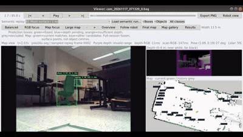
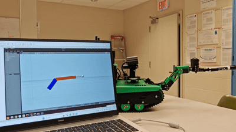
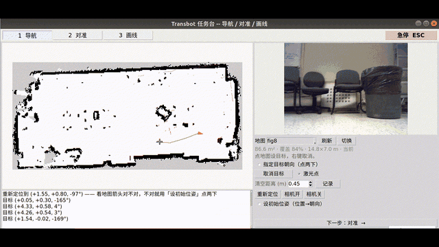

# Transbot

Semantic mapping, remote control, arm simulation and wall tasks for the Yahboom Transbot tracked robot, using ROS 1 Melodic.

[中文](README.md) ｜ **English**

## Projects

<!-- projects:start -->
| Project | Directory | Scope |
|---|---|---|
| Semantic Mapping Studio | [semantic_mapping/](semantic_mapping/README.en.md) | Recording, verified transfer, map rebuilding and RGB-D semantic replay; first demo stage complete |
| Remote console | [console/](console/README.md) | Chassis, peripherals, arm, cameras and online mapping/navigation |
| 2R arm | [arm/](arm/README.md) | Measured kinematics, Gazebo and real-robot synchronization |
| Wall task console | [wall_task/](wall_task/README.md) | Navigation, alignment and vertical-line planning; full drawing workflow still needs robot validation |
<!-- projects:end -->

## Semantic Mapping Studio

The offline workflow connects acquisition, quality review, map reconstruction, object detection and localization, semantic replay, and final-map export. YOLO26s and YOLO26s Segmentation are the standard presets. Results stay with their recording sessions.



*RGB detections, aligned depth and map object candidates replayed together.*

```bash
cd ~/transbot/semantic_mapping
bash run_en.sh
```

Keep large data outside the source checkout. Configure existing recording and model directories in the ignored `paths.local.json`; original data stays in place. Raw bags, annotation datasets, model weights and generated runs are excluded from Git. See the [project guide](semantic_mapping/README.en.md).

## Architecture

Windows hosts development and annotation. Ubuntu runs the four independent applications, online navigation, offline mapping and Gazebo. The Jetson owns hardware drivers, the ROS master and local recording. Offline semantic analysis reads existing bags and does not require a robot connection.

See the [system architecture](docs/ARCHITECTURE.md) for module boundaries, data flow, process ownership and documentation rules. The robot should have one active online control workflow; the applications do not yet share a global control lock.

## Other launchers

```bash
cd ~/transbot/console
source env.sh
bash tasks/00-health-check.sh
bash run_gui.sh

cd ~/transbot/arm
bash gazebo/run_simple.sh

cd ~/transbot/wall_task/task_gui
bash start_task.sh --offline
```





## Runtime

| Environment | Role |
|---|---|
| Windows host | Development, version control, annotation and presentation materials |
| Ubuntu control PC | GUI, transfers, offline mapping and semantics, navigation and Gazebo |
| Jetson robot | Hardware drivers, RGB-D and lidar streams, odometry and local recording |

Hardware drivers run on the robot. Existing recordings can be analyzed on the control PC while the robot is offline.

## Layout

```text
transbot/
  semantic_mapping/   Semantic Mapping Studio source, docs and tests
  console/            Remote console
  arm/                Arm modelling and simulation
  wall_task/          Wall-task console
  docs/               Project index and repository conventions
  _local/             Local material, tooling and archives; ignored
```

Any remaining local `bagtools/` directory stores existing data or history only. The control PC retains its data under `~/robot_research/bagtools/`; the new source checkout references it through local configuration. Source history is consolidated in the Transbot repository, with no nested source repository.

The project tables are generated from `docs/projects.json`. Run `python3 tools/check_repository.py --write-index` after editing that registry, then stage files and run `python3 tools/check_repository.py`. GitHub Actions checks published links, launchers, syntax and data exclusions, and runs offline tests.

Ubuntu 18.04 / ROS Melodic is used on the control PC, with Jetson Nano / JetPack 4.5 on the robot. Semantic tools use Python 3 for the GUI, ROS Python 2 for bags, and an isolated Conda environment for YOLO. See each project for its dependencies.

Joint limits: j7 0–225°, j8 15–240°, j9 60–180°. Geometry is documented in [arm/CALIBRATION.md](arm/CALIBRATION.md).

MIT License — [LICENSE](LICENSE).
