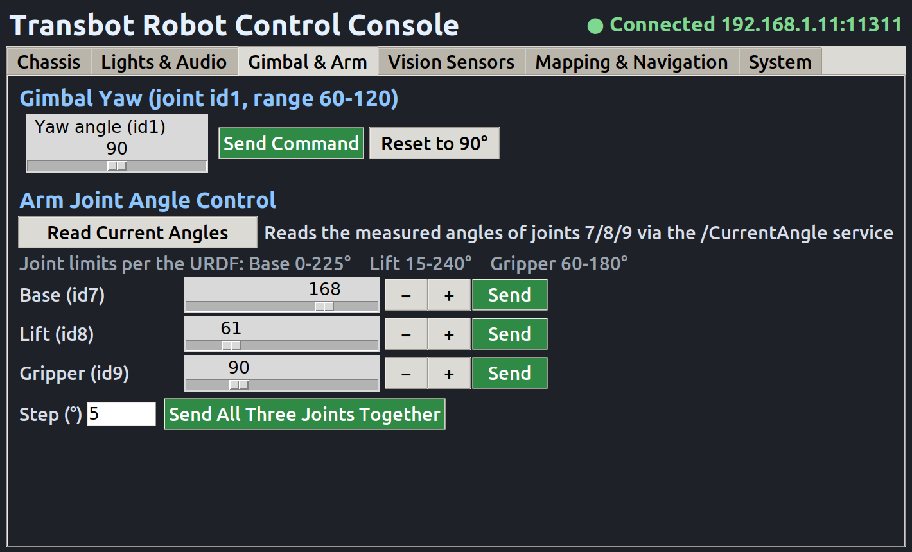
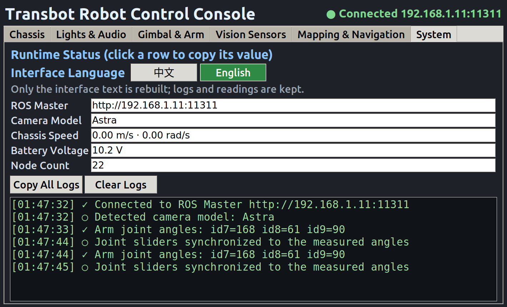
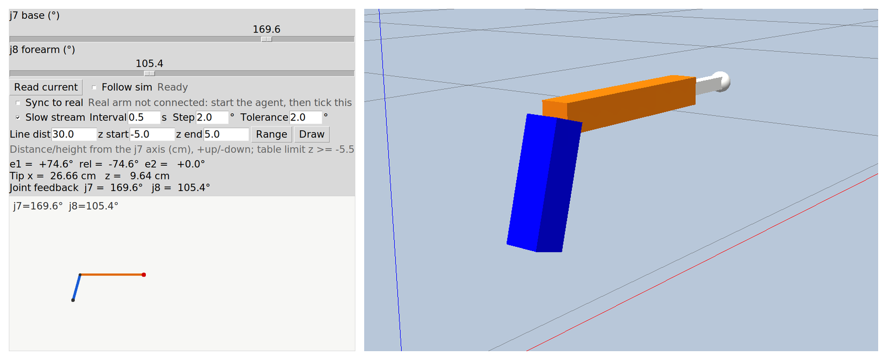

# Transbot

Two projects on a Yahboom Transbot tracked robot (ROS 1 Melodic): a PC-side remote
console, and modelling / simulation / real-robot sync for its 2-DOF arm.

[中文](README.md) ｜ **English**

  


*Left: the Gazebo control panel on a laptop. Right: the real 2R arm holding a marker,
following the same joint angles.*

## Projects

The two subprojects are independent and share one set of geometric parameters and
joint limits.

### `console/` — PC-side remote console

| Gimbal & arm | System status |
|---|---|
|  |  |

A six-tab tkinter console that takes over the whole robot over WiFi:

- **Chassis** — one-shot commands plus a 20 Hz continuous speed loop, auto-brake on key
  release or timeout
- **Peripherals** — six LED effects, buzzer, gimbal, lidar avoid / follow / warn zones,
  line following
- **Arm** — three joint sliders with `/CurrentAngle` readback
- **Vision** — Astra RGB and depth, captured on the robot and displayed on the PC
- **Mapping & navigation** — start and stop the robot-side gmapping / move_base from the
  GUI; save, pull and back up maps
- **Finding the robot** — `env.sh` resolves the address via hotspot, router or mDNS, and
  the GUI still opens when the robot is offline
- **No catkin build** — ships the official `transbot_msgs` modules, so a new machine only
  needs ROS Melodic and `python3-tk`

See [`console/README.md`](console/README.md) for the full guide.

### `arm/` — 2R arm modelling and simulation



A planar 2R arm in Gazebo with a control panel:

- The two sliders are the two joint angles; the side view shows `e1 / rel / e2` and the
  pen-tip position live
- Give it a distance and a z range and it plans a vertical line, stepping through the
  Jacobian
- A UDP agent mirrors the same angles onto the real servos, with a slow stream and a
  Cartesian closed loop
- `line_tool.py` is pure kinematics: FK / IK / reachable range / line planning
- **Measured geometry** — L1, L2 and the j7 axis position were re-measured with a tape;
  the vendor URDF is 1.72cm off, which would put the pen tip 1–2cm away from where the
  loop thinks it is

See [`arm/README.md`](arm/README.md) for the full guide.

## Two machines

The runtime is two separate computers with separate accounts; they are not
interchangeable.

| | Control PC | Robot mainboard |
|---|---|---|
| Arch / OS | x86_64, Ubuntu 18.04 | aarch64, Jetson Nano / L4T (JetPack 4.5) |
| SSH user | your own PC account | `jetson` |
| Owns | `console/`, `arm/` sim, rviz | `/dev/ttyTHS1`, `/dev/rplidar`, `/scan`, `/odom` |
| Role | teleop, visualization, Gazebo | base driver, lidar, mapping, navigation |

Anything that touches a serial device — base driver, lidar, mapping, navigation — must run
on the mainboard. `console/` only publishes topics and visualizes; `arm/`'s Gazebo scene
runs on the PC and syncs to the real arm through the UDP agent.

## Quickstart

```bash
git clone https://github.com/Xeyrion/transbot.git
cd transbot

# Console
cd console
source ./env.sh                 # auto-detect the robot, sets ROS_MASTER_URI / ROS_IP
bash tasks/00-health-check.sh   # all green before continuing
bash run_gui.sh                 # graphical console

# Arm simulation (its own local ROS master; the robot is untouched)
cd ../arm
./gazebo/run_simple.sh
```

Pin a robot IP (optional; the hotspot default is `192.168.1.11`):

```bash
mkdir -p ~/.config && echo 'ROBOT_IP=<robot-ip>' > ~/.config/transbot_console.conf
```

## Layout

```
transbot/
├── console/              PC-side remote console
│   ├── transbot_gui.py     six-tab tkinter console
│   ├── env.sh              robot address discovery + ROS environment
│   ├── run_gui.sh          launcher (preflight + master probe)
│   ├── scripts/            keyboard teleop / arm self-test / peripheral demo
│   ├── tasks/              one-liner entries 00~10
│   ├── docs/               setup / advanced / benchmark
│   ├── examples/arm_min/   /TargetAngle from `rostopic pub` to checked readback
│   ├── maps/  rviz/        sample map and RViz configs
│   └── vendor/             prebuilt transbot_msgs (no catkin needed)
└── arm/                  arm modelling and simulation
    ├── gazebo/             Gazebo 2R scene + control panel
    ├── robot_side/         UDP ↔ ROS bridge (runs next to the robot)
    ├── line_tool.py        2R kinematics / reachable range / line planning
    ├── draw_line.py        command-line line drawing
    ├── CALIBRATION.md      measured calibration record
    └── tests/              18 unit tests
```

## Joint limits

| Joint | Servo id | Range |
|---|---|---|
| base j7 | 7 | 0–225° |
| lift j8 | 8 | 15–240° |
| gripper j9 | 9 | 60–180° (158–160° grips the marker) |

The console, teleop script, UDP agent and examples all share these values. The driver does
not clamp arm angles — this protection lives on the sending side.

## Requirements

- Ubuntu 18.04 + ROS Melodic on the control PC; the robot runs Jetson Nano / JetPack 4.5
- `python3-tk`, `rospy`, `opencv-python`, `numpy`, `Pillow`, `cv_bridge` — see
  `console/requirements.txt`
- Robot and PC on the same WiFi (robot hotspot or a shared router)
- Mapping / navigation / lidar / line following need the vendor `transbot_nav`,
  `transbot_laser`, `transbot_linefollow` packages on the robot side

`arm/tests` holds 18 unit tests; every `console/` script passes `bash -n` and `py_compile`
on Ubuntu 18.04 / Python 3.6.9.

## License

MIT — see [`LICENSE`](LICENSE).
