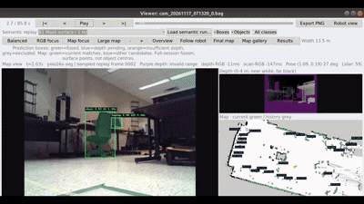
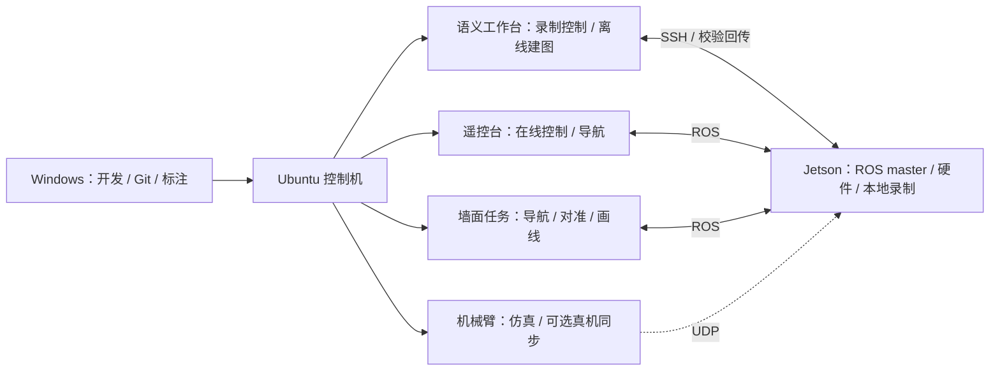
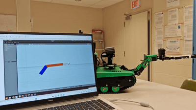
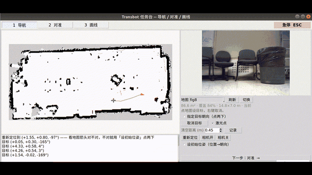

# Transbot

Yahboom Transbot 履带机器人的语义建图、遥控、机械臂与墙面任务项目，基于 ROS 1；控制机兼容 Melodic 和 Noetic，机器人使用 Melodic。

**中文** ｜ [English](README.en.md)

## 项目入口

<!-- projects:start -->
| 项目 | 目录 | 当前范围 |
|---|---|---|
| 语义建图工作台 | [semantic_mapping/](semantic_mapping/README.md) | 多模态录制、校验回传、二维建图与 RGB-D 语义回放；第一阶段演示完成 |
| PC 遥控台 | [console/](console/README.md) | 底盘、外设、机械臂、相机及在线建图导航 |
| 2R 机械臂 | [arm/](arm/README.md) | 实测运动学、Gazebo 仿真与真机同步 |
| 墙面任务台 | [wall_task/](wall_task/README.md) | 导航、对准与竖线规划；完整画线流程仍待真机验证 |
<!-- projects:end -->

各项目独立启动。语义建图的阶段完成范围和后续研究见[阶段总结](semantic_mapping/docs/stage_01.md)。

## 语义建图工作台

**Transbot Semantic Mapping Studio** 已贯通采集 → 数据检查 → 地图重建 → 物品识别与定位 → 语义回放 → 最终地图导出。常用方案为 YOLO26s 与 YOLO26s 分割，结果按录制会话管理。



*彩色识别框、深度和地图物品候选点同时回放。*

```bash
cd ~/transbot/semantic_mapping
bash run.sh       # 中文
bash run_en.sh    # English
```

源码与大数据分开：本机 `paths.local.json` 引用现有 bag 与模型位置，数据保持原处。仓库不包含原始包、标注数据集、模型权重和批量生成结果。初次配置见[项目说明](semantic_mapping/README.md#源码与数据分开)。

## 总体架构



四个应用独立运行，共用同一机器人时需要明确控制权。在线导航在控制机计算；机器人负责硬件驱动。离线语义研究读取已有包，不要求机器人在线。完整的模块边界、数据流、坐标前提及文档维护规则见 **[整体架构说明](docs/ARCHITECTURE.md)**。

## 其他入口

```bash
# PC 遥控台
cd ~/transbot/console
source env.sh
bash tasks/00-health-check.sh
bash run_gui.sh

# 机械臂仿真：独立本机 ROS master
cd ~/transbot/arm
bash gazebo/run_simple.sh

# 墙面任务台：离线预览
cd ~/transbot/wall_task/task_gui
bash start_task.sh --offline
```





## 运行分工

| 环境 | 职责 |
|---|---|
| Windows 主机 | 开发、源码管理、标注及演示材料 |
| Ubuntu 控制机 | GUI、数据回传、离线地图与语义算法、导航规划、Gazebo |
| Jetson 机器人 | 硬件驱动、雷达与相机数据、里程计、机器人本地录制 |

底盘和雷达串口设备只能由机器人端驱动访问。控制机通过 ROS/SSH 使用数据和下发命令；机器人离线时仍可在控制机分析已有数据。

## 目录约定

```text
transbot/
  semantic_mapping/   语义建图工作台源码、文档与测试
  console/            PC 遥控台
  arm/                机械臂建模与仿真
  wall_task/          墙面任务台
  docs/               项目导航及仓库约定
  _local/             本机资料、工具缓存与归档，不上传
```

本机旧 `bagtools/` 若仍存在，仅保存原位置的数据、模型、结果或历史 Git 备份，不是新版启动目录；不要移动其中的原始数据。控制机数据仍在 `~/robot_research/bagtools/`，由新项目本机配置引用。

源码及当前说明由 Git 管理。提交前用 `git status` 核对范围；大数据、运行产物、本机配置与工具缓存均忽略。子项目原有记录与 Transbot 历史一起保留，不再在源码目录中嵌套独立仓库。

项目表来自 `docs/projects.json`，修改后运行 `python3 tools/check_repository.py --write-index`。提交文件后运行 `python3 tools/check_repository.py` 检查入口、文档链接和发布范围；GitHub Actions 自动重复检查与离线测试。详见[架构和文档约定](docs/ARCHITECTURE.md#文档如何保持一致)。

## 环境与硬件参数

控制机支持 Ubuntu 18.04 / ROS Melodic 或 Ubuntu 20.04 / ROS Noetic；机器人为 Jetson Nano / JetPack 4.5 / Melodic。语义工作台的 GUI 使用 Python 3，bag 解释器跟随本机 ROS，YOLO 在独立 Conda 或 venv 环境运行，具体依赖见各项目说明。

机械臂使用实测几何及统一关节限位：j7 为 0–225°，j8 为 15–240°，j9 为 60–180°。详见 [arm/CALIBRATION.md](arm/CALIBRATION.md)。

MIT License，见 [LICENSE](LICENSE)。
