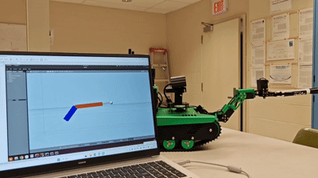
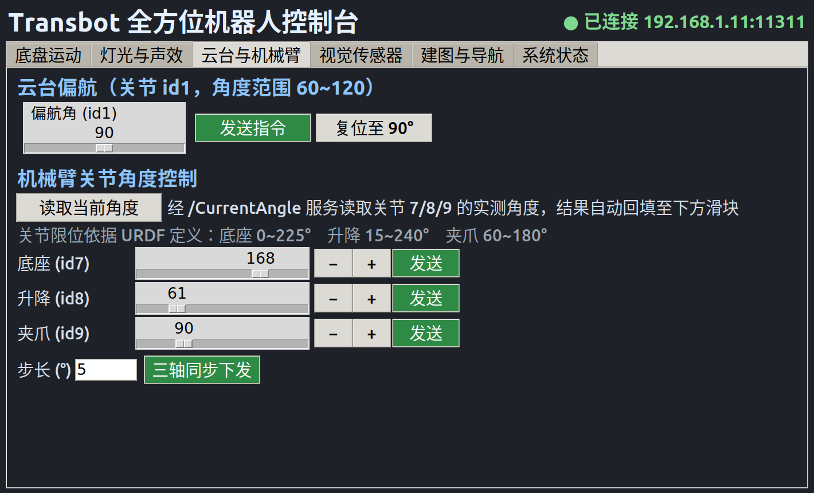
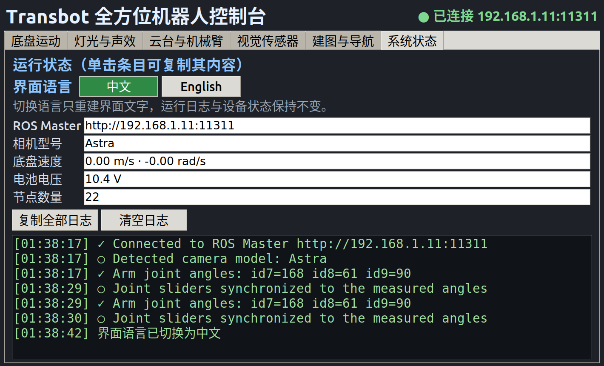
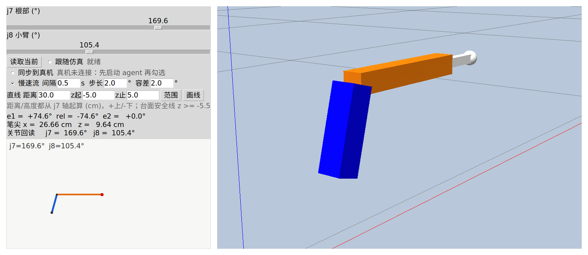

# Transbot

Yahboom Transbot 履带机器人（ROS 1 Melodic）上的两个项目：PC 端遥控台，以及 2R 机械臂的建模、仿真与真机同步。

**中文** ｜ [English](README.en.md)

  



*左边笔记本上跑 Gazebo 控制面板，右边真机 2R 臂夹着马克笔同步到同一组角度。*

## 项目

两个子项目互相独立，共用同一套几何参数与关节限位。

### `console/` — PC 端遥控台

| 云台与机械臂 | 系统状态 |
|---|---|
|  |  |

六页签 tkinter 控制台，通过 WiFi 接管整台机器人：

- **底盘** —— 单次指令 + 20 Hz 连续速度，松键或超时自动刹车
- **外设** —— 灯带六种特效、蜂鸣、云台、雷达避障 / 跟随 / 警戒、黑线巡游
- **机械臂** —— 三个关节滑块，配 `/CurrentAngle` 角度回读
- **视觉** —— Astra RGB 与深度在机器人端取流，PC 端显示
- **建图导航** —— 图形界面远程启停机器人端的 gmapping / move_base，地图可保存、拉取、备份
- **找机器人** —— `env.sh` 按热点 / 路由器 / mDNS 自动解析地址，机器人离线时界面仍可打开
- **免 catkin** —— 内置官方 `transbot_msgs` 预编译模块，新机器只要 ROS Melodic + `python3-tk`

详细用法见 [`console/README.md`](console/README.md)。

### `arm/` — 2R 机械臂建模与仿真



Gazebo 里的平面 2R 机械臂，配一个控制面板：

- 两个滑块就是两个关节角，右侧实时侧视图给出 `e1 / rel / e2` 与笔尖坐标
- 给定距离和 z 起止，规划一条竖线并按雅可比步进下发
- 通过 UDP agent 把同一组角度同步到真机舵机，带慢速流与笛卡尔闭环
- `line_tool.py` 是纯计算的运动学：FK / IK / 可达范围 / 直线规划
- **实测几何** —— L1、L2、j7 轴位置全部按钢卷尺重标；厂家 URDF 差 1.72cm，照它算笔尖会偏 1~2cm

详细用法见 [`arm/README.md`](arm/README.md)。

## 双机架构

运行环境由两台独立计算机组成，职责不可互换。

| | 控制 PC | 机器人主板 |
|---|---|---|
| 架构 / 系统 | x86_64，Ubuntu 18.04 | aarch64，Jetson Nano / L4T (JetPack 4.5) |
| SSH 用户 | 本机账号 | `jetson` |
| 资源 | `console/`、`arm/` 仿真、rviz | `/dev/ttyTHS1`、`/dev/rplidar`、`/scan`、`/odom` |
| 职责 | 遥控、可视化、Gazebo | 底盘驱动、雷达、建图、导航 |

依赖串口设备的组件（底盘驱动、雷达、建图、导航）只能在主板上运行。
`console/` 仅发布话题与做可视化；`arm/` 的 Gazebo 场景运行在 PC 端，通过 UDP agent 与真机同步。

## 快速开始

```bash
git clone https://github.com/Xeyrion/transbot.git
cd transbot

# 遥控台
cd console
source ./env.sh                 # 自动发现机器人，设置 ROS_MASTER_URI / ROS_IP
bash tasks/00-health-check.sh   # 全绿再往下
bash run_gui.sh                 # 图形控制台

# 机械臂仿真（独立的本机 ROS master，不影响机器人）
cd ../arm
./gazebo/run_simple.sh
```

固定机器人 IP（可选，热点模式默认 `192.168.1.11`）：

```bash
mkdir -p ~/.config && echo 'ROBOT_IP=<robot-ip>' > ~/.config/transbot_console.conf
```

## 目录

```
transbot/
├── console/              PC 端遥控台
│   ├── transbot_gui.py     6 页签 tkinter 控制台
│   ├── env.sh              机器人地址发现 + ROS 环境
│   ├── run_gui.sh          启动器（预检 + master 探测）
│   ├── scripts/            键盘遥控 / 机械臂自检 / 外设演示
│   ├── tasks/              00~10 一键入口
│   ├── docs/               setup / advanced / benchmark
│   ├── examples/arm_min/   /TargetAngle 最小示例（三级递进）
│   ├── maps/  rviz/        示例地图与 RViz 配置
│   └── vendor/             预编译 transbot_msgs（免 catkin）
└── arm/                  机械臂建模与仿真
    ├── gazebo/             Gazebo 2R 场景 + 控制面板
    ├── robot_side/         UDP ↔ ROS 桥（跑在真机侧）
    ├── line_tool.py        2R 运动学 / 可达范围 / 直线规划
    ├── draw_line.py        命令行画线
    ├── CALIBRATION.md      实测标定记录
    └── tests/              18 项单元测试
```

## 关节限位

| 关节 | 舵机 ID | 范围 |
|---|---|---|
| 底座 j7 | 7 | 0–225° |
| 升降 j8 | 8 | 15–240° |
| 夹爪 j9 | 9 | 60–180°（夹笔实测 158–160°） |

控制台、遥控脚本、UDP agent 与示例共用这一组值。驱动本身不校验角度，这层保护在发送端。

## 环境

- Ubuntu 18.04 + ROS Melodic（控制 PC 与机器人主板各一台，机器人侧为 Jetson Nano / JetPack 4.5）
- `python3-tk`、`rospy`、`opencv-python`、`numpy`、`Pillow`、`cv_bridge`，见 `console/requirements.txt`
- 机器人与 PC 在同一 WiFi（机器人热点或同一路由器）
- 建图 / 导航 / 雷达 / 巡线依赖厂家 `transbot_nav`、`transbot_laser`、`transbot_linefollow`，这些跑在机器人端

`arm/tests` 18 项单元测试；`console/` 全部脚本通过 `bash -n` 与 `py_compile`（Ubuntu 18.04 / Python 3.6.9）。

## License

MIT，见 [`LICENSE`](LICENSE)。
