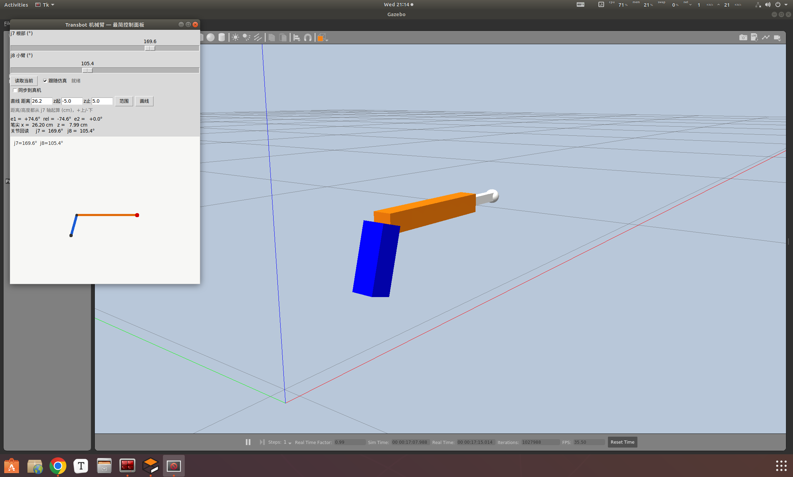
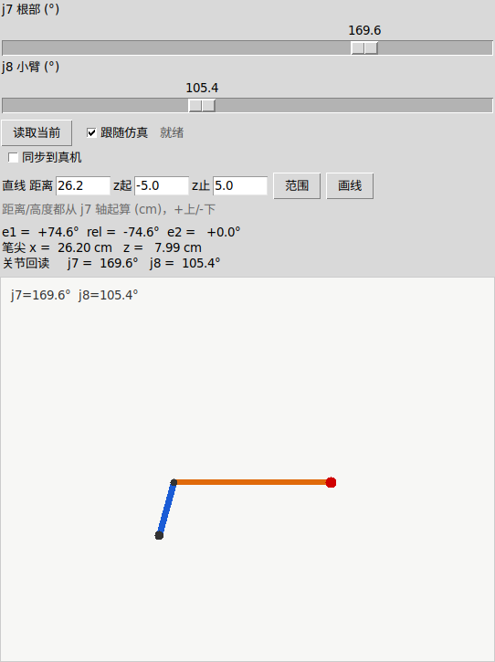
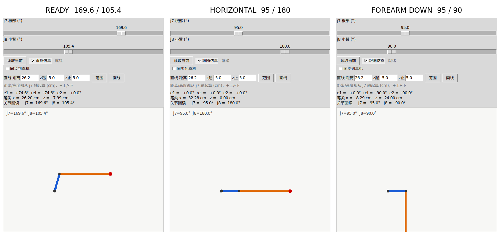
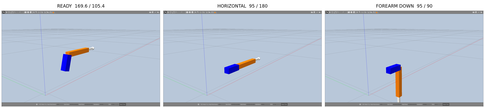
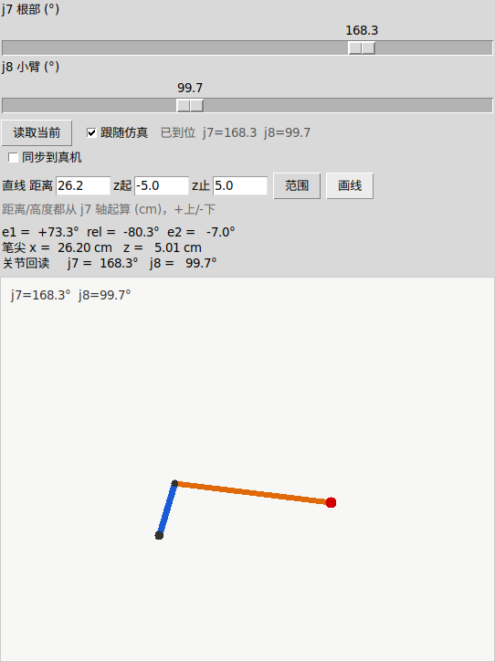

# transbot_arm_simple — 最简 Gazebo 机械臂（无墙/地板场景）

Gazebo 里只放**一个平面 2R 机械臂**：没有墙、没有地面模型、没有墙距/地板输入、
带 `--real` 启动时真机同步默认开启：对齐真机后滑块同时发真机，限制显示在开关旁边；
没有矫正模式、没有标定文件。两个滑块分别对应两个关节，滑块位置即目标角度。

- ROS Melodic / Gazebo 9
- 纯 `launch/urdf/world` 包，不需要 catkin 编译
- 控制器：`position_controllers/JointGroupPositionController`
- 话题：`/arm_controller/command`（`std_msgs/Float64MultiArray`，两个关节角）

几何和角度口径**以人工实测为准，不用厂家 URDF 的安装值**。完整标定记录
见 `CALIBRATION.md`：

```text
e1  = j7 - 95           第一节仰角；j7=95 -> 第一节水平
rel = j8 - 180         小臂相对角；j8=180 -> 两节共线
e2  = e1 + rel         第二节世界仰角
L1 = 10.0 cm（j7 轴 -> j8 轴，钢卷尺实测）
L2 = 24.0 cm（j8 轴 -> 笔尖，j9≈159 夹笔）
j7 轴：x=12.9 cm，离地 8.0 cm
```

URDF 里的 8.285 cm 是厂家模型，和实际安装差 1.72 cm；真机 FK/IK 用它会
让笔尖位置整体偏 1~2 cm。本项目 `line_tool.py` 和 Gazebo 的
`arm_simple.urdf` 都已改成实测 10.0 cm。

**角度限位以最新控制台 GUI 为准**（`../console/transbot_gui.py`）：

| 关节 | 范围 | 说明 |
|---|---|---|
| j7 底座 | 0° ~ 225° | 与原 `arm_simple` 面板一致 |
| j8 升降 | 15° ~ 240° | 与原 `arm_simple` 面板一致 |
| j9 夹爪 | 60° ~ 180° | 夹笔实测 158~160° |

`line_tool.py` 的 `J7_MIN/J7_MAX`、`J8_MIN/J8_MAX` 已与 GUI 对齐；仿真 URDF
的关节限位换算后也是同一组值。不要把 `arm_min` 旧文档里的 30~270 当成真机限位。

## 界面与姿态

以下截图均来自 Gazebo 仿真与本地面板，不含实拍画面。

**面板与三维视图（ready pose，j7=169.6 / j8=105.4）**



**侧视图与读数（勾选「跟随仿真」，滑块实时跟随仿真位形）**



**三种姿态对照（侧视）**：READY 169.6/105.4、HORIZONTAL 95/180、FOREARM DOWN 95/90



**同一组姿态的 Gazebo 三维对照**



**手动拖动接管**：在 Gazebo 中拖动机械臂后，「跟随仿真」自动取消，
面板显示「已到位」并回读角度（j7=149.4 / j8=105.4）


**画线结束（z 止 = 5 cm）**：笔尖 x=26.20 / z=5.01 cm，关节回读 j7=168.3 / j8=99.7



## 1. 快速开始

```bash
cd arm
./gazebo/run_simple.sh              # 关闭已有场景，启动全新 Gazebo + 控制面板
./gazebo/run_simple.sh gui:=false   # 无头 Gazebo + 面板
./gazebo/run_simple.sh -- --j7 95 --j8 180   # 面板初始姿态
./gazebo/run_simple_en.sh           # 英文演示面板（同一场景、同一行为）
```

每次运行都是全新场景：如果已有 Gazebo 在跑，脚本先把它停掉再起新的。
场景是 detached 的：关面板、关终端，场景继续跑；重跑本脚本起全新，`./gazebo/stop_simple.sh` 彻底停止。

两套场景不能同时跑（会抢同一个本机 ROS master）。旧的 `transbot_arm` 工程
（含墙/地板/box 逻辑）不在本仓库内；本项目只保留当前这套最简场景。

启动后应该看到：

- 只有两节杆（蓝色大臂 + 橙色小臂 + 白色笔 + 红色笔尖），没有底座、没有地面、没有墙；
- `/joint_states` 有 `arm_joint1`、`arm_joint2`；
- 臂自动摆到 ready pose（`j7=169.6 / j8=105.4`）。

## 2. 控制面板

```text
j7 根部 (°)   [滑块 0 .. 225]
j8 小臂 (°)   [滑块 15 .. 240]
[读取当前] [跟随仿真□]
[同步到真机☑] 真机 j7=-- j8=-- --V ...
[慢速流☑] 间隔[0.5]s 步长[2.0]° 容差[2.0]°
直线 距离[30.0] z起[-5.0] z止[5.0] [范围] [画线]
```

- 滑块范围就是舵机硬限位，面板不做任何额外限制；拖滑块自动发仿真
- 「读取当前」：滑块对齐仿真当前位置；「跟随仿真」默认勾选，滑块/预览实时跟仿真走
  （CLI 画线、别的程序动臂、面板画线都能看见）；跟随只读，不发仿真/真机命令，
  手动一拖自动接管并关闭跟随；勾真机同步时也会自动关掉跟随
- 「同步到真机」见第 4 节；「慢速流」和「范围/画线」见第 4、5 节
- 英文演示版：`./gazebo/run_simple_en.sh`，等价于
  `./gazebo/run_simple.sh -- --lang en`；只翻译标签和状态文字，
  控制逻辑、默认参数、真机同步/画线行为与中文版完全一样
- 右侧是实时侧视图：只有两节臂 + 笔尖；
- 左下角读数：`e1 / rel / e2`、笔尖坐标（j7 轴起 cm）、关节回读。

## 3. 文件

```text
gazebo/run_simple.sh                        一键启动（杀旧起新，场景 detached + 面板）
gazebo/run_simple_en.sh                     英文演示入口（等价于 -- --lang en）
gazebo/stop_simple.sh                       彻底停止场景和面板
gazebo/transbot_arm_simple/
  package.xml / CMakeLists.txt            纯资源包，无需编译
  urdf/arm_simple.urdf                    2R 臂（固定零点 95/180）
  worlds/arm_simple.world                 空世界：只有灯光，没有地面/墙
  launch/arm_simple.launch                场景 + 控制器 + 初始位
  config/controllers.yaml                 joint_state + arm 位置控制器
  scripts/arm_simple_gui.py               最简面板（唯一可交互程序）
  scripts/set_pose_simple.py              命令行摆位：set_pose_simple.py J7 J8
robot_side/run_simple_agent.sh              启动 UDP agent（--read-only / --box）
robot_side/arm_udp_agent.py                 UDP ↔ ROS 桥（Python 2，跑在真机侧）
line_tool.py                                几何换算 + 直线范围计算
draw_line.py                                画线入口（先显示范围，再执行）
CALIBRATION.md                              实测标定记录
```

## 4. 真机同步（可选升级）

面板可以把滑块角度同步发给真机，链路是 UDP（本机面板 → agent → 真机 `/TargetAngle`）。

> **运行环境**：`run_simple_agent.sh` 用 `python2` 启动 agent —— ROS Melodic 的
> `rospy` 默认是 Python 2。脚本语法本身兼容 py2/py3，但能否 `import rospy` /
> `transbot_msgs` 由 Melodic 环境决定。agent 要连真机的 ROS master，通常放在
> Jetson 上跑，也可以放在任何能访问该 master 的机器上。
>
> **安全**：agent 默认**使能**，会真的驱动舵机。第一次务必先 `--read-only`
> 确认 state 回包（真机 j7/j8/电压）正常，再开运动。默认 `box 0` 表示除舵机
> 硬限位外没有额外保护；收紧测试范围用 `--box 30`。丢包超过看门狗时间后
> agent 不再发新目标，机械臂保持原位。

```bash
# 终端 1：启动 agent（先只读验链路，不会动真机）
./robot_side/run_simple_agent.sh --read-only
# 看到 state 回包（真机 j7/j8/电压）后再换成使能模式：
./robot_side/run_simple_agent.sh            # box 0 = 只受舵机硬限位约束

# 终端 2：启动面板，默认连接本机 agent
./gazebo/run_simple.sh
```

`run_simple_agent.sh` **默认就是使能 + box 0**；只有显式加 `--read-only`
才是只读。看到日志 `mode=READ-ONLY` 就说明启动时手动带了 `--read-only`，
不是脚本默认行为。

面板启动后默认直连本机 `127.0.0.1:42100` 的 agent（IP 不变所以不用填）。
`--real` 只有 agent 不在本机时才需要，后面跟 **agent 所在机器的 IP**
（面板把角度用 UDP 发到它的 42100 端口），比如 agent 上了 Jetson 就填 Jetson 的 IP；
`--real ''` 则彻底关闭真机同步。agent 没启动时面板显示未连接，勾选同步会被拒绝。

面板里勾选「同步到真机」后拖滑块，仿真和真机一起动。行为说明：

- 面板带 `--real`（默认 `127.0.0.1`）时「同步到真机」默认勾选；启动约
  1.2s 后先对齐真机当前位形，**对齐完成前绝不发 set**
- 真机默认走「慢速流」：每 0.5s 一包、每包最多 2°，`run_time=间隔+100ms`；
  容差默认 2.0°，覆盖 1~2° 的舵机死区，差值进入容差就换下一个点，不要求
  精确到位
- 慢速流是闭环的：每包都从**真机实测角**重新计算，不会将最终角一次性下发
- 真机画线是**笛卡尔闭环**：每包先用实测 j7/j8 做 FK 得到真实笔尖位置，沿
  预先校验过的笔尖路径（先直线接近，再沿竖线）往前看 `1.2cm`，IK 后发一小步。
  实测停在原地时，前视距离会从 `1.2cm` 慢慢加到 `2.5cm`，同时关节前导角从
  2° 加到 5°，所以命令本身会变大、越过死区，而不是停发
- 接近段也是笛卡尔直线：从当前笔尖直接走到竖线起点，不会在中途向墙或台面
  外凸；如果笔尖已经在台面以下，会先在当前 x 竖直抬到台面安全线再横移
- 真机画线时，仿真不再跑自己的快速队列，而是每个 tick 跟随真机实测 j7/j8；
  真机慢仿真就慢，真机停仿真也停
- 真机回读（角度/电压/限制/`[只读]`）显示在开关右边；断开后自动暂停发送
- agent 默认 box 0：除舵机硬限位外无额外保护；要收紧用 `--box 30`
- 30cm 距离时几何极限是 z=±16.0（臂展 34cm），但两端已接近完全伸直；加
  2cm 臂展余量后安全范围是 z=-11.1..+11.1，再按台面截到 -5.5..+11.1
  （约16.6cm）。想画 20cm 以上应把距离改到 26.2cm 左右（-5.5..+18.35，
  约23.9cm）；30cm 距离硬画 ±16 会顶到台面/伸到极限（上次堵转的原因）

## 5. 直线工具（三步：定直线 → 输距离 → 显示范围）

```bash
python3 draw_line.py 26.2            # 只显示该距离上的可画高度范围
python3 draw_line.py 26.2 5.0 15.0   # 范围内才画：笔尖沿竖线走 z 5→15 cm
```

- 距离 = j7 轴到直线的水平距离（cm）；高度从 j7 轴起算（cm，+上/-下）；
  面板直线行、CLI `draw_line.py` 都是这个口径；老文档的地面起算不用了
- CLI 负高度写法：`python3 draw_line.py 26.2 -- -3 7`（`--` 后面跟负数）
- 画之前先打印范围，起点终点超出范围直接拒绝不执行
- **台面限制**：`J7_AXIS_Z=8cm`，`FLOOR_MARGIN=2.5cm`，所以
  `Z_FLOOR_REL=-5.5cm`。面板「范围」默认只显示这条线以上的部分。
- **臂展余量**：`REACH_MARGIN=2cm`，规划直线时不允许贴近完全伸直
  （`REACH_MAX=34.0cm`，d_max=32.0cm）。30cm 距离下安全范围是
  `z=-11.1..+11.1`，按台面截到 `-5.5..+11.1`（约16.6cm）；26.2cm 距离下是
  `z=-5.5..+18.35`（约23.9cm）。30cm 距离想画到 ±16 会把肘部拉到接近
  奇异点，真机容易堵转/掉电。当前 wallmark 的 40cm standoff（base_link→墙）
  换算到 j7 轴约 27.1cm，正好落在这个安全范围里。
  手动把 z 填到安全范围外会给出警告，真机会顶到台面或伸到极限
- 几何来源和复测方法见 `CALIBRATION.md`；换笔或重新安装后先复测 `L1/L2`
  再画线
- 角度口径是勘误后的（e1=j7-95、rel=j8-180）；存档老代码 `rel=j7+j8-275`
  把第二节世界角 `e2` 当成了相对角 `rel`，重复计入 j7（(169.6,30.8) 会使笔尖
  插入地面以下），本工具不使用该口径

## 6. 直接命令行摆位（不需要开面板）：

```bash
export ROS_PACKAGE_PATH=$(pwd)/gazebo:$ROS_PACKAGE_PATH   # 在 arm/ 目录下执行
export ROS_MASTER_URI=http://127.0.0.1:11311
rosrun transbot_arm_simple set_pose_simple.py 95 180
```

## 7. 和旧工程的关系

| | transbot_arm（旧，已归档） | transbot/arm（当前，原 arm_simple） |
|---|---|---|
| 场景 | 臂 + 墙 + 可调地面 | 只有臂 |
| 面板 | 墙距/地板/box/真机同步/矫正 | 两滑块 + 图线 + 真机慢速流/跟随 |
| 零点 | `arm_calib.json` 可标定 | 固定 95/180 |
| 真机同步 | UDP agent + 面板开关 + box | 同左（本工程默认 box 0，同步默认开） |
| 限制 | 穿墙/入地/box 拦截发真机 | 只做台面范围提示，不拦截 |
| 旧代码位置 | 不在本仓库（已移除） | — |
