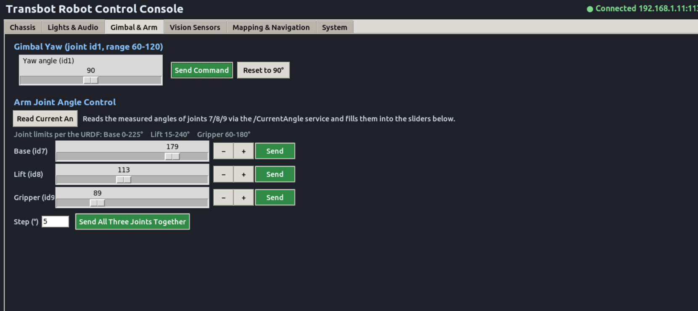
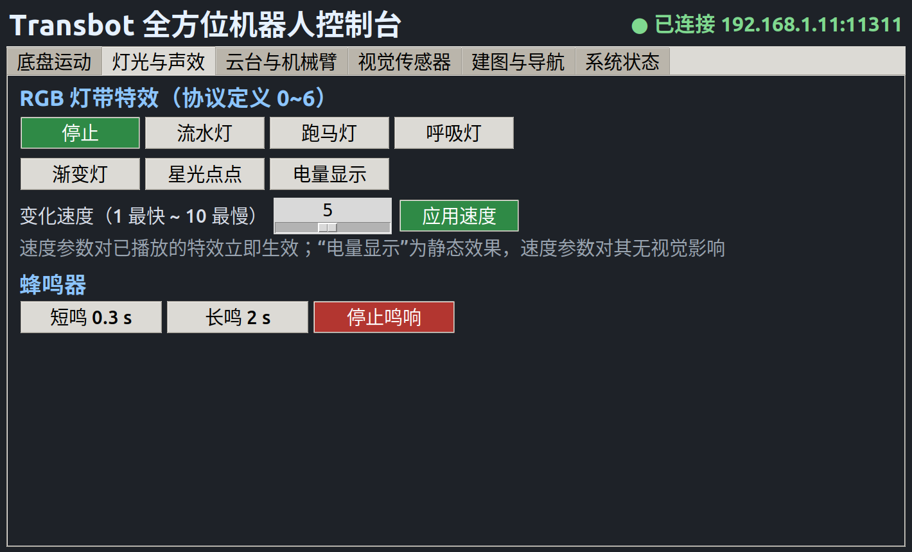
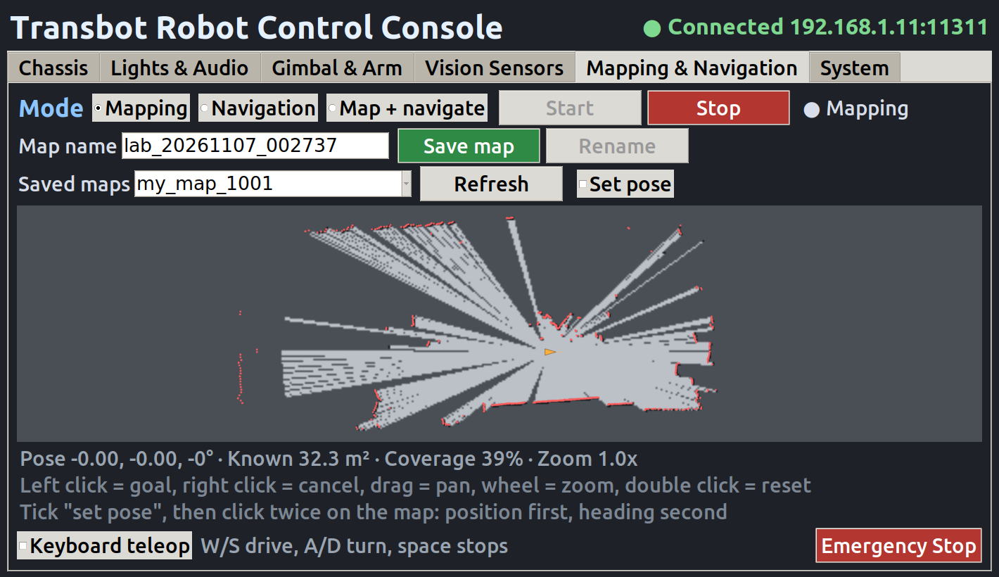

# Transbot Remote Console

> This is the detailed reference. For the Chinese overview see [../README.md](../README.md).

System boundaries and documentation ownership: [architecture guide](../docs/ARCHITECTURE.md).

PC-side console for the Yahboom Transbot robot (ROS 1 Melodic). Everything goes
through the ROS master on the robot — nothing has to be copied onto it.

  

| Chassis | Lights & audio | Mapping & navigation |
|---|---|---|
|  |  |  |

*Three of the six tabs, connected to a live robot. The third one is mid-mapping:
the radial fan is a single scan from a robot that has not moved yet.*

## Two machines

The control PC and the robot mainboard are separate computers with separate
accounts, and they are not interchangeable.

| | Control PC (this directory) | Robot mainboard |
|---|---|---|
| Arch / OS | x86_64, Ubuntu 18.04 | aarch64, Ubuntu 18.04 / L4T (JetPack) |
| SSH user | your own PC account | `jetson` |
| Owns | GUI, teleop, planners, rviz | `/dev/ttyTHS1`, `/dev/rplidar`, `/scan`, `/odom` |

Anything that touches a serial device — the base driver and the lidar — must
run **on the mainboard**. Mapping and navigation do not: they only consume
`/scan`, `/odom` and `/tf`, so `nav/` runs them here, where one process tree
owns the whole stack and stopping it cannot leave half of it behind.
`tasks/10-mapping-ssh.sh` prints the mainboard-side commands.

## Highlights

1. **Zero-config robot discovery** (`env.sh`) — resolves the robot IP via
   `$ROBOT_IP` → config file → AP default → mDNS, discards mDNS self-hits when the
   PC shares the robot's hostname, and picks the local `ROS_IP` on the robot's
   subnet. ROS workspaces load first so the GUI still opens when the robot is
   offline, and `transbot_msgs` falls back to the bundled copy when no catkin
   workspace is built.
2. **Safety-first motion** — new velocity commands preempt old ones, 20 Hz command
   loop, auto-brake after 0.5–5 s idle, hard caps (0.4 m/s, 2.0 rad/s),
   brake-on-exit.
3. **One GUI for everything** (`transbot_gui.py`, tkinter, zh/en) —
   six tabs: keyboard-driven chassis (W/S/A/D, space to brake, speed from two
   sliders), RGB/buzzer effects, arm + gimbal sliders with `/CurrentAngle`
   readback, camera/depth viewer, mapping & navigation, system status. Keys act
   only on the visible tab and never while an entry has focus.
4. **Three ways to map and drive, one window** — mapping, navigation and
   map+navigate share a live map canvas: click to send a goal, drive with
   WASD, save and rename maps in place. The stack, the scan filter and the
   angular-gain relay are started and stopped from the same button. See
   [`nav/README.md`](nav/README.md).

The base is velocity-controlled — stop sending and it keeps the last speed — which is why
the GUI re-sends `/cmd_vel` at 20 Hz and brakes on timeout. The arm is position-controlled:
one message per move, and the loop closes inside the servo. That asymmetry explains both
the command loop and the `/CurrentAngle` readback.

## Quickstart

```bash
source ./env.sh                 # auto-detect robot, sets ROS_MASTER_URI / ROS_IP
bash tasks/00-health-check.sh   # all green before continuing
bash tasks/01-keyboard-drive.sh # i / , / j / l / k
bash run_gui.sh                 # graphical console (6 tabs)
bash tasks/03-view-mapping.sh   # rviz mapping view (needs gmapping on robot)
```

Pin a robot IP (optional; the AP default is `192.168.1.11`):

```bash
mkdir -p ~/.config && echo 'ROBOT_IP=<robot-ip>' > ~/.config/transbot_console.conf
```

## Layout

```
console/
├── env.sh                # robot IP discovery + ROS_MASTER_URI / ROS_IP
├── run_gui.sh            # GUI launcher (preflight + master probe + exec)
├── transbot_gui.py       # tkinter console (6 tabs)
├── check_robot.sh        # health check (voltage / scan / odom / arm / nodes)
├── config.example.conf   # template for the pinned-IP config
├── scripts/
│   ├── arm_teleop.py     # keyboard teleop: arm+gimbal (left) + base (right)
│   ├── demo_actions.py   # light / buzzer / gimbal / arm demo, base never moves
│   └── arm_probe.py      # arm self-test: neutral pose + per-joint probe
├── nav/                  # mapping / navigation / both (see nav/README.md)
│   ├── panel.py          #   the tab: mode, map controls, canvas, teleop
│   ├── stack.py          #   preflight + roslaunch, one process tree
│   ├── mapview.py        #   OccupancyGrid -> PIL -> Tk, plus a 2D TF shim
│   ├── model.py          #   subscriptions and state that outlive the widgets
│   ├── launch/           #   map.launch, nav.launch, slam_nav.launch
│   ├── param/            #   tuned planner parameters (copies)
│   └── helpers/          #   scan_filter, cmd_vel_scale, clock_guard, keepalive
├── tasks/                # one-liner entries, 00 first (see tasks/README.md)
├── examples/arm_min/     # /TargetAngle from `rostopic pub` to checked readback
├── maps/                 # saved maps (yaml + pgm + json), and a sample
├── vendor/
│   ├── python/           # prebuilt transbot_msgs (no catkin needed)
│   └── transbot_msgs_src/  # official msg/srv definitions
├── rviz/                 # camera.rviz, mapping.rviz
└── docs/                 # setup.md, advanced.md, benchmark.md
```

## Mapping & navigation

One tab, three modes. All three share the same live map canvas and the same
`maps/` directory; the only difference is which stack is running.

| Mode | What runs (here, not on the robot) | What you do |
|---|---|---|
| Mapping | `scan_filter` + gmapping | drive with the keyboard, watch the map grow, save it |
| Navigation | `map_server` + AMCL + move_base + keepalive | pick a saved map, click a goal, or drive by hand |
| Map + navigate | `scan_filter` + gmapping + move_base | both at once; the planner uses the map as it grows |

```bash
bash run_gui.sh        # then open the "Mapping & Navigation" tab
```

1. pick a mode, press **Start**. The stack comes up here, the log lands in the
   **System** tab, step by step (`1/7 robot reachable` … `verify`)
2. mapping and map+navigate start with a timestamp name
   (`lab_20261106_231530`) that you can edit or **Rename** later; a name that
   already exists is flagged next to the field and confirmed before overwrite
3. navigation uses the **Use map** dropdown. If the pose is wrong: **Read** to
   pull the current pose into the fields, **Send pose** to type coordinates,
   **Set pose** + two clicks on the map, or **Re-localise** to match the
   current scan against the whole map (it reports whether the answer is unique
   or has a 180° twin)
4. **Keyboard teleop**: W/S forward and back, A/D turn, space stops. It needs
   the teleop checkbox; typing in a text field is never swallowed
5. click the map to send a goal (0.30 m clearance is checked first), right
   click cancels. Tick **Goal heading** to set the final heading with a second
   click. The view: drag pans, wheel zooms at the cursor, **Shift + drag**
   rotates continuously, `[` / `]` rotate, `+` / `-` zoom, double click or
   **Reset** returns to the default fit

The info line under the map carries the pose, AMCL's own σ, known area,
coverage, battery and the move_base status. It warns once when σ crosses
0.20 m or the battery drops below 11 V — both look like "the goal was
ignored" otherwise.

In the normal relay path, teleop and goal-following share one `/cmd_vel`
writer. `nav/helpers/cmd_vel_scale.py` arbitrates: `move_base`
publishes `/cmd_vel_raw`, the keyboard publishes `/cmd_vel_teleop`, and a
teleop message mutes the planner for 0.3 s before forwarding. Switching is one
message period — no process is started or killed, and the driver never sees two
20 Hz streams alternating. Pressing a direction key cancels any active goal;
sending a goal switches teleop off.

The GUI retains a direct `/cmd_vel` teleop fallback while the relay is down.
This is local console behavior, not a global lock shared with other tools.

Maps are `maps/<name>.yaml` + `.pgm` + `.json` (area, coverage, pose, odometry
distance at save time). The yaml's `image:` is rewritten to the bare file name
on save, so the folder stays portable.

The stack runs on this machine on purpose: the robot only has to publish
`/scan`, `/odom` and `/tf`, and one process tree means **Stop** really stops
everything. Parameters in `nav/param/` are the tuned copies — see
[`nav/README.md`](nav/README.md) for what changed and why.

## Arm joint limits

Shared by the GUI, the teleop script and `examples/arm_min`:

| Joint | Servo id | Range |
|---|---|---|
| base (j7) | 7 | 0–225° |
| lift (j8) | 8 | 15–240° |
| gripper (j9) | 9 | 60–180° |

The driver does not clamp arm angles — this protection lives on the sending side.
See `docs/setup.md` for the full guide, `docs/advanced.md` for lidar /
line-follow / arm / mapping notes, and `docs/benchmark.md` for measured
WiFi/video numbers.

## Requirements

- Ubuntu 18.04 + ROS Melodic on the control PC, robot on the same WiFi (AP or STA)
- Vendor packages on the ROS path: `transbot_msgs` (bundled in `vendor/`, catkin
  build optional), `transbot_laser` / `transbot_linefollow` (tasks 05/06 only),
  `teleop_twist_keyboard`, `rqt_image_view`, `rviz`
- Python: `rospy`, `python3-tk`, `opencv-python`, `numpy`, `Pillow`, `cv_bridge`
  (see `requirements.txt`)

This repo contains the console, scripts, launchers and docs, plus the bundled
`transbot_msgs` definitions. Vendor firmware and driver packages are **not**
included.

## License

MIT — see [`LICENSE`](../LICENSE).
