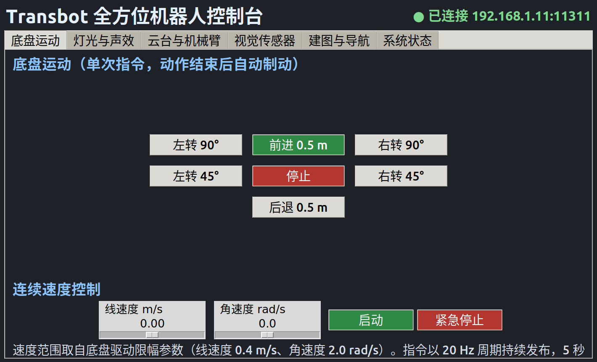
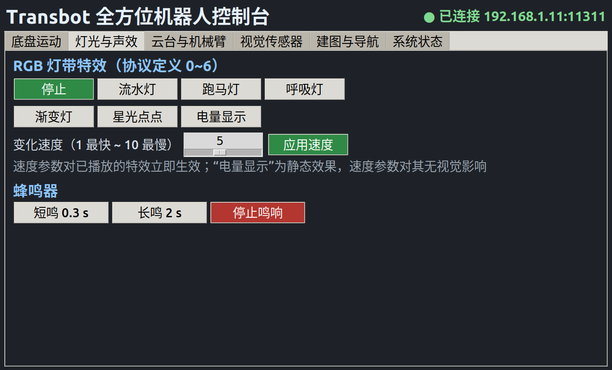

# Transbot Remote Console

> 中文概览见 [../README.md](../README.md)。本文件是英文详细说明。

PC-side console for the Yahboom Transbot robot (ROS 1 Melodic). Everything goes
through the ROS master on the robot — nothing has to be copied onto it.

  

| Chassis | Lights & audio |
|---|---|
|  |  |

*Two of the six tabs, connected to a live robot.*

## Two machines

The control PC and the robot mainboard are separate computers with separate
accounts, and they are not interchangeable.

| | Control PC (this directory) | Robot mainboard |
|---|---|---|
| Arch / OS | x86_64, Ubuntu 18.04 | aarch64, Ubuntu 18.04 / L4T (JetPack) |
| SSH user | your own PC account | `jetson` |
| Owns | GUI, teleop, rviz | `/dev/ttyTHS1`, `/dev/rplidar`, `/scan`, `/odom` |

Anything that touches a serial device — base driver, lidar, mapping and
navigation — must run **on the mainboard**. This directory only publishes topics
and visualizes; `tasks/10-mapping-ssh.sh` prints the mainboard-side commands.

## Highlights

1. **Zero-config robot discovery** (`env.sh`) — resolves the robot IP via
   `$ROBOT_IP` → config file → AP default → mDNS, discards mDNS self-hits when the
   PC shares the robot's hostname, and picks the local `ROS_IP` on the robot's
   subnet. ROS workspaces load first so the GUI still opens when the robot is
   offline, and `transbot_msgs` falls back to the bundled copy when no catkin
   workspace is built.
2. **Safety-first motion** — new velocity commands preempt old ones, 20 Hz command
   loop, auto-brake after 0.5–5 s idle, hard caps (0.4 m/s, 2.0 rad/s),
   brake-on-exit.
3. **One GUI for everything** (`transbot_gui.py`, ~2.9k lines, tkinter, zh/en) —
   six tabs: base drive, RGB/buzzer effects, arm + gimbal sliders with
   `/CurrentAngle` readback, camera/depth viewer, mapping/navigation launcher,
   system status.

The base is velocity-controlled — stop sending and it keeps the last speed — which is why
the GUI re-sends `/cmd_vel` at 20 Hz and brakes on timeout. The arm is position-controlled:
one message per move, and the loop closes inside the servo. That asymmetry explains both
the command loop and the `/CurrentAngle` readback.

## Quickstart

```bash
source ./env.sh                 # auto-detect robot, sets ROS_MASTER_URI / ROS_IP
bash tasks/00-health-check.sh   # all green before continuing
bash tasks/01-keyboard-drive.sh # i / , / j / l / k
bash run_gui.sh                 # graphical console (6 tabs)
bash tasks/03-view-mapping.sh   # rviz mapping view (needs gmapping on robot)
```

Pin a robot IP (optional; the AP default is `192.168.1.11`):

```bash
mkdir -p ~/.config && echo 'ROBOT_IP=<robot-ip>' > ~/.config/transbot_console.conf
```

## Layout

```
console/
├── env.sh                # robot IP discovery + ROS_MASTER_URI / ROS_IP
├── run_gui.sh            # GUI launcher (preflight + master probe + exec)
├── transbot_gui.py       # tkinter console (6 tabs)
├── check_robot.sh        # health check (voltage / scan / odom / arm / nodes)
├── config.example.conf   # template for the pinned-IP config
├── scripts/
│   ├── arm_teleop.py     # keyboard teleop: arm+gimbal (left) + base (right)
│   ├── demo_actions.py   # light / buzzer / gimbal / arm demo, base never moves
│   └── arm_probe.py      # arm self-test: neutral pose + per-joint probe
├── tasks/                # one-liner entries, 00 first (see tasks/README.md)
├── examples/arm_min/     # /TargetAngle from `rostopic pub` to checked readback
├── maps/                 # sample map (my_map_1001.pgm/.yaml)
├── vendor/
│   ├── python/           # prebuilt transbot_msgs (no catkin needed)
│   └── transbot_msgs_src/  # official msg/srv definitions
├── rviz/                 # camera.rviz, mapping.rviz
└── docs/                 # setup.md, advanced.md, benchmark.md
```

## Arm joint limits

Shared by the GUI, the teleop script and `examples/arm_min`:

| Joint | Servo id | Range |
|---|---|---|
| base (j7) | 7 | 0–225° |
| lift (j8) | 8 | 15–240° |
| gripper (j9) | 9 | 60–180° |

The driver does not clamp arm angles — this protection lives on the sending side.
See `docs/setup.md` for the full guide, `docs/advanced.md` for lidar /
line-follow / arm / mapping notes, and `docs/benchmark.md` for measured
WiFi/video numbers.

## Requirements

- Ubuntu 18.04 + ROS Melodic on the control PC, robot on the same WiFi (AP or STA)
- Vendor packages on the ROS path: `transbot_msgs` (bundled in `vendor/`, catkin
  build optional), `transbot_laser` / `transbot_linefollow` (tasks 05/06 only),
  `teleop_twist_keyboard`, `rqt_image_view`, `rviz`
- Python: `rospy`, `python3-tk`, `opencv-python`, `numpy`, `Pillow`, `cv_bridge`
  (see `requirements.txt`)

This repo contains the console, scripts, launchers and docs, plus the bundled
`transbot_msgs` definitions. Vendor firmware and driver packages are **not**
included.

## License

MIT — see [`LICENSE`](../LICENSE).
