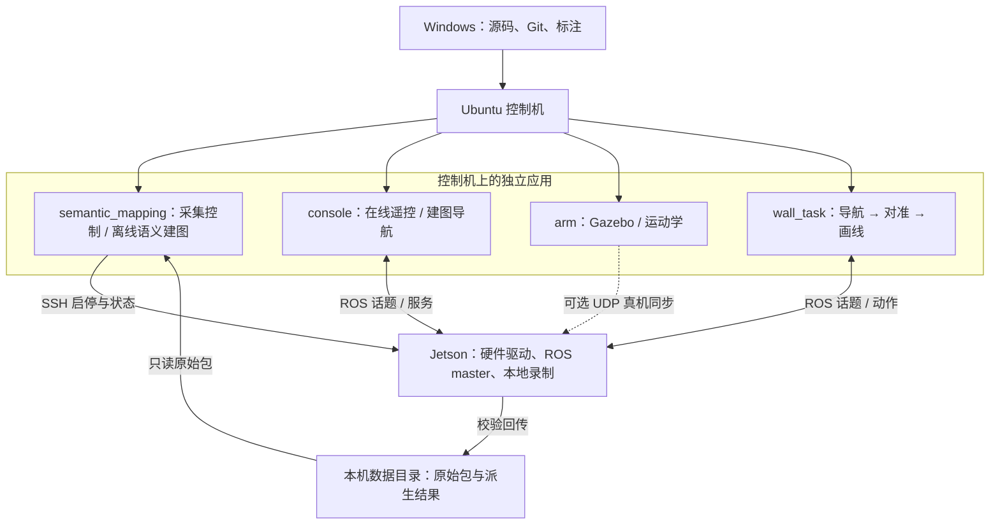
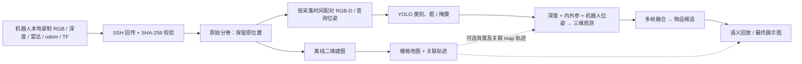

# Transbot 整体架构

这里维护跨项目的运行分工、模块边界和数据流。操作步骤由各项目 README 维护，算法参数以源码配置为准。项目名称、目录和启动入口登记在 [projects.json](projects.json)，根目录中英文项目表由该清单生成。

## 三种运行环境

| 环境 | 运行内容 | 不承担的职责 |
|---|---|---|
| Windows 主机 | 开发、Git、标注、演示材料 | 不直接访问机器人串口，不作为 ROS Melodic 运行环境 |
| Ubuntu 控制机 | 四个项目的界面、在线建图导航、离线建图与语义计算、Gazebo | 不拥有机器人的硬件设备 |
| Jetson 机器人 | ROS master、底盘/相机/雷达驱动、里程计、机器人本地录制；可选机械臂 UDP agent | 不运行控制机 GUI 或离线 YOLO 研究流程 |

在线工具连接机器人 ROS master。机械臂 Gazebo 使用独立本机 master；离线地图重建使用私有 master，回放话题经过允许列表，不向真实底盘回放控制指令。



## 四个项目的边界

| 项目 | 主要实现 | 输入 → 输出 | 状态与配置归属 |
|---|---|---|---|
| `semantic_mapping/` | `workbench.py`；`recording/`；`mapping_job.py`；`semantic/`；常驻 bag 阅读器 | 原始 bag、标定、模型 → 地图、轨迹、三维观测、物品候选、回放及 PNG | `project_paths.py` + 本机 `paths.local.json`；地图和语义结果属于对应录制 |
| `console/` | `transbot_gui.py`；`nav/model.py` 保存状态；`nav/panel.py` 展示；`nav/stack.py` 管进程 | 实时 ROS 数据、键盘和目标 → 遥控指令、在线地图、导航目标 | `env.sh` 解析机器人与 ROS 环境；`nav/param/`、`nav/launch/` 和 `maps/` |
| `arm/` | `line_tool.py`；Gazebo 包；`robot_side/` UDP agent | 关节角或线段参数 → FK/IK、仿真关节命令、可选真机目标 | 实测几何见 `CALIBRATION.md`；仿真 ROS master 与真机 ROS master 分离 |
| `wall_task/` | `task_gui/` 阶段界面；`nav/` 任务导航；`wallline/` 任务运动学 | 地图、目标、雷达距离、机械臂反馈 → 导航、人工对准、线段执行 | `maps/current` 选地图；`nav/param/`；轨迹诊断写入用户数据目录 |

`wall_task` 的启动脚本复用 `console/env.sh`。除此以外，四个项目不是彼此嵌套启动的一套服务。墙面任务使用自己的 `wallline/line_tool.py`，并未直接导入 `arm/line_tool.py`；两者目前保持独立测试。

## 语义建图的数据流



栅格图像不是物品定位的前提。单帧统一坐标定位也需要深度、相机内外参和机器人位姿；没有关联地图时使用 odom 位姿。底图可选不等于位姿可省略。详细算法只在[语义算法文档](../semantic_mapping/docs/semantic_algorithm.md)维护。

GUI 使用 Python 3；ROS Melodic bag 读取与抽帧使用 ROS Python 2；YOLO 使用独立 Conda Python。阅读器通过常驻子进程交换帧和状态，避免在 GUI 解释器中混装 ROS 与模型依赖。

这是语义工作台的解释器分工；`arm/` 的 Gazebo 面板使用 Melodic 的 Python 2 / Tkinter，与控制台和墙面任务的 Python 3 界面不同。导航重定位可选用 SciPy 加速，语义实验比较图额外使用 Matplotlib。GitHub 的 Python 3.11 离线检查不代替这些 ROS 运行环境。

```text
源码仓库：transbot/semantic_mapping/
  paths.example.json       可提交的示例
  paths.local.json         本机外部数据 / 权重位置，不提交

本机 data_dir/<会话>/      数据保持原位置，不随源码移动
  *.bag                    原始分卷
  calibration.json         本次采集配置
  maps/<录制名>/           当前地图、轨迹和 association.json
  semantic/<录制名>/
    <运行名>/              样本、检测、观测、融合及可选地图快照
    gallery/               最终展示图
    comparisons/           本录制的实验对照
```

现有控制机继续使用 `~/robot_research/bagtools/bags` 和 `models`。其他安装可配置自己的目录。旧存储路径不是第二套源码工程。原始 bag、权重、标注图片、批量输出、本机配置和 `_local` 均不发布；仓库只带选定的小型示例地图与演示素材。

## 进程与控制权

- **在线导航与录制不是同一任务。** `console/nav`、墙面任务启动器含校时及清理 ROS 节点的操作；不能在正式录制中并行启动这些维护流程。当前没有跨四个应用的统一控制锁。
- **控制台内部正常路径**：`move_base → /cmd_vel_raw`，键盘 → `/cmd_vel_teleop`，速度中继仲裁后发 `/cmd_vel`。代码还保留中继失败时遥控直发 `/cmd_vel` 的降级路径，因此“唯一出口”只适用于中继正常工作的配置。
- **墙面任务**：自己的阶段切换取消导航目标，并在导航、人工对准、画线之间切换；该联锁不是其他 GUI 的全局联锁。
- **机械臂仿真**：场景 detached 运行；关闭面板不会关闭 Gazebo，使用 `arm/gazebo/stop_simple.sh` 停止场景。真机同步必须有相应 UDP agent。
- **离线研究**：已有包的语义生成不需要机器人在线。任务输出、地图快照和来源校验使回放可以追溯，不能用画面正常代替位置精度验证。

因此，同一机器人一次由一套在线控制流程接管；离线计算与已有数据阅读可以独立运行。

## 文档如何保持一致

| 信息 | 维护位置 | 修改时同步检查 |
|---|---|---|
| 项目名、目录、公开入口 | `docs/projects.json` | 运行 `python3 tools/check_repository.py --write-index` 更新中英文首页项目表 |
| 主机分工、项目边界、数据和控制流 | 本文 | 跨模块依赖或部署职责变化时修改本文 |
| 日常操作 | 对应项目 README | 启动参数与 GUI 行为变化时同步 |
| 语义算法、标定与阶段边界 | `semantic_mapping/docs/` | 参数以源码和配置为准，文档链接其来源 |
| 在线导航参数 | `console/nav/launch/`、`param/`；墙面任务对应目录 | 独立场景的配置不假定自动同步 |
| 演示素材 | 对应项目 `docs/images/` 或已有 `screenshots/` | 保留本地原始录屏，只提交适合网页的版本 |

提交前先 `git add` 本次文件，再运行 `python3 tools/check_repository.py`。检查以 Git 收录范围为准，能发现“本机有文件、GitHub 却没有”的文档链接、未收录的入口、项目表不同步和误收录的大数据。GitHub Actions 重复这些检查并运行离线测试。

自动检查覆盖结构和链接，不会证明算法说明与运行行为完全相符。改动算法、控制权、时钟或坐标约定时仍需同步对应说明并做针对验证。

## 后续架构工作

当前按四个独立应用交付，边界已明确；尚未收敛成共享控制服务。优先研究跨工具的录制/导航/校时控制权，再考虑合并重复的导航辅助脚本和运动学实现。GUI 中仍有较大的单文件，后续可沿现有“界面、状态、进程、纯算法”边界拆分；本次文档和发布整理不改变运动算法。
