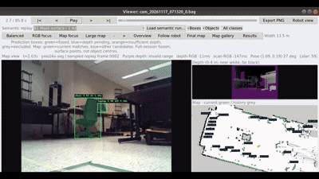

# Transbot Semantic Mapping Studio

Stage 1 provides an offline semantic-mapping demonstration: multimodal recording, verified transfer, quality review, map rebuilding, RGB-D detection and localization, object fusion, replay and final-map export.



See the [system architecture](../docs/ARCHITECTURE.md) for runtime ownership and project boundaries.

```bash
cd ~/transbot/semantic_mapping
bash run_en.sh
bash install_workbench.sh
```

Copy `paths.example.json` to the ignored `paths.local.json`. Set `data_dir` to your existing recordings and `models_dir` to your existing weights. Set `archive_dir` to relocate mapping build archives, for example onto an external drive. Data stays in place. Without this file, paths default to `bags/`, `models/` and `archive/` beside the source. Environment overrides: `BAGTOOLS_DATA_DIR` / `LOCAL_DIR`, `BAGTOOLS_MODELS_DIR`, and `BAGTOOLS_ARCHIVE_DIR`.

The current control-PC installation continues using `~/robot_research/bagtools/bags` and `~/robot_research/bagtools/models`. Raw bags, images, datasets, weights, generated runs and local configuration are excluded from Git.

Open Recording Console to prepare drivers and time, enter a recording name, start or stop acquisition, and retrieve verified data. The name takes effect on Start. In Session Browser, select a recording, rebuild its map or generate semantics using YOLO26s or YOLO26s Segmentation. An animated progress bar shows activity, stage and elapsed time.

Use semantic replay to inspect RGB boxes/masks, aligned depth, rejection reasons and numbered object candidates. Map gallery opens final PNGs; More provides run folders and generation help. Each recording stores its own `maps/<stem>/` and `semantic/<stem>/` results.

An occupancy-grid background is optional. Localization requires valid depth, camera intrinsics/extrinsics and robot poses. Odom-only results may drift. Object candidates represent estimated visible surfaces, not verified object centers or counts. Quantitative localization evaluation and crack segmentation remain future research.

Runtime: Ubuntu 18.04 / ROS Melodic or Ubuntu 20.04 / ROS Noetic. The GUI uses Python 3; bag tools select Python 2 for Melodic and Python 3 for Noetic. Set `TRANSBOT_ROS_SETUP` or `BAGTOOLS_ROS_PYTHON` to override detection. YOLO runs in an isolated Conda or venv environment; set `yolo_python` in `paths.local.json` or `BAGTOOLS_YOLO_PYTHON` to its interpreter. An already mounted external drive can hold `data_dir` and `models_dir`. See the [Chinese guide](README.md), [English demo guide](docs/english_demo.md) and [stage summary](docs/stage_01.md).
