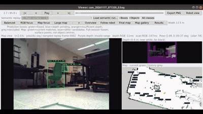

# Transbot 语义建图工作台

**Transbot Semantic Mapping Studio · 第一阶段：离线语义建图演示**

从 RGB-D 与二维雷达录制，到数据检查、二维地图重建、物品识别、三维定位及语义回放的控制机工具。当前阶段已完成可演示的离线流程，范围见[阶段总结](docs/stage_01.md)。



整个仓库的主机分工与项目边界见[整体架构](../docs/ARCHITECTURE.md)。

```bash
cd ~/transbot/semantic_mapping
bash run.sh               # 中文工作台
bash run_en.sh            # English workbench
bash install_workbench.sh # 安装或更新桌面入口
```

## 日常流程

1. **录制控制**：录前准备、填写名称、开始与停止录制，按文件校验后回传。
2. **数据阅读**：选择会话，分析或逐帧查看 RGB、深度、雷达与位姿。
3. **建图 / 重新建图**：从包内数据生成二维地图和关联轨迹；替换前确认，旧图集中归档。
4. **生成语义地图**：选择 YOLO26s 或 YOLO26s 分割，后台抽帧、识别、投影与融合。动态进度条显示阶段和已用时间。
5. **语义回放 / 地图图库**：查看推理框、掩膜、深度拒绝原因、物品候选点，导出最终地图或三合一图片。

栅格底图可选，三维定位需要有效深度、相机内外参和机器人位姿。没有底图时使用 odom 坐标。候选点代表物品可见表面的估计位置；精度验证和裂缝分割属于下一阶段。

## 源码与数据分开

```text
transbot/semantic_mapping/     GitHub 项目源码
  workbench.py, run*.sh        中英文启动入口
  bag_quality_gui.py          会话管理、阅读器、建图与语义任务
  recording/                  采集、状态、回传及统一外参配置
  semantic/                   抽帧、投影、检测、融合与标注导出
  paths.example.json          数据与模型路径配置示例
  paths.local.json            本机配置，不提交 Git
  docs/, tests/, locale/      当前文档、验证与翻译

<本机数据根目录>/<会话>/      保持原位置，不随源码移动或上传
  *.bag                       原始分卷、回传记录和标定副本
  maps/<录制名>/              当前地图、轨迹和关联信息
  semantic/<录制名>/          各次语义运行、gallery/、comparisons/
```

复制 `paths.example.json` 为 `paths.local.json`，设置 `data_dir` 与 `models_dir`。现有控制机配置继续引用 `~/robot_research/bagtools/bags` 和 `~/robot_research/bagtools/models`，数据、标注图片、模型及生成结果均保持原位置。没有本机配置时默认使用项目旁的 `bags/` 和 `models/`。相对路径按项目目录解析，与启动时所在目录无关。

环境变量 `BAGTOOLS_DATA_DIR`、`LOCAL_DIR` 以及 `BAGTOOLS_MODELS_DIR` 可覆盖本机配置；`SEMANTIC_WEIGHTS` 用于自定义模型命令行。机器人本地录制根目录仍为 `/home/jetson/bags`。移动源码后重新运行桌面入口安装器。

源码纳入 Transbot 主仓库，原 Bagtools Git 历史保留。大数据、权重、运行输出、归档和本机配置全部排除在提交之外。

## 文档与验证

- [阶段总结](docs/stage_01.md) · [当前状态](docs/project_status.md)
- [使用与回放](docs/workbench.md) · [工作流](docs/workflow.md)
- [架构](docs/architecture.md) · [建图](docs/mapping_button.md)
- [语义算法](docs/semantic_algorithm.md) · [相机外参](docs/calibration.md)
- [裂缝图片与分割标注](semantic/LABELING.md)

控制机：Ubuntu 18.04 / ROS Melodic；GUI 使用 Python 3，bag 读取使用 ROS Python 2，YOLO 使用独立 Conda 环境。

```bash
source /opt/ros/melodic/setup.bash
python3 -m unittest discover -s tests
BAGTOOLS_GUI_TEST=1 xvfb-run -a python3 -m unittest discover -s tests -p test_gui.py
bash rebuild_map.sh /path/to/recording/first.bag           # 首次建图
bash rebuild_map.sh /path/to/recording/first.bag --replace # 更新，旧图归档
```
