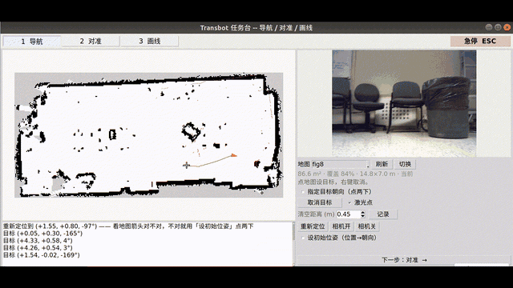

# Wall task — navigation, alignment and marking

The task console combines map-based navigation, manual alignment and a 2R arm vertical-line workflow. The demo shows navigation on the robot. A historical marking demonstration is recorded in the task guide; the relocated version still needs an end-to-end robot check and has no measured marking accuracy.



See the [system architecture](../docs/ARCHITECTURE.md) for module boundaries and control ownership.

```bash
cd wall_task/task_gui
./start_task.sh --offline       # preview without the robot
./start_task.sh                 # robot discovery, preflight and navigation
./start_task.sh --no-nav        # connect without starting navigation
./start_task_en.sh              # English UI
```

The control machine needs Ubuntu 18.04 / ROS Melodic or Ubuntu 20.04 / ROS Noetic, the dependencies in `console/`, `sshpass`, gmapping, AMCL, move_base and the Transbot robot on the same network. The shared `runtime/ros_env.sh` selects local ROS. The robot supplies its own Melodic hardware drivers and Astra packages. `ROBOT_IP`, `ROBOT_USER` and `ROBOT_SSH_PASS` override connection defaults.

`task_gui/` is the task console, `nav/` contains its launch files, helpers and tuned planner parameters, `maps/` contains the original example maps, `wallline/` contains the task-specific kinematics, and `map_gui/`, `slam_nav/` and `tools/` are the supporting tools. `maps/current` selects the initial navigation map; the task GUI can change it. Navigation traces go to `~/.local/share/transbot/wall_task/traces`.

The online launcher can stop conflicting ROS nodes and synchronize the robot clock. Check the working area and emergency stop before enabling motion. The arm has no force feedback; marking contact and line accuracy are not yet verified. See [task_gui/README.md](task_gui/README.md) for the detailed operation and original measurements.
