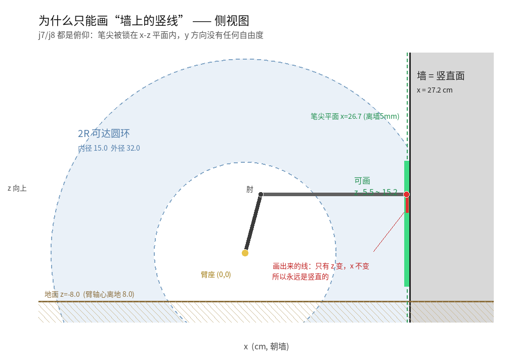

# 08 为什么只能画“墙上的竖线”



> 图：`docs/img/section_why_vertical.png`（生成脚本思路见文末）。
> 灰色 = 墙（竖直面 x=常数），棕色 = 地面，浅蓝 = 2R 可达圆环，
> 绿带 = 在墙上能落笔的 z 区间，红线 = 实际画出来的 3cm 线。

## 一句话

**j7、j8 都是俯仰 → 笔尖只有 x、z 两个自由度；墙又是 x=常数的竖直面，
所以笔尖落在墙上时只剩 z 一个自由度 → 只能画竖线。**

这不是额外加的约束，是“2 自由度平面臂 + 画在墙上”共同决定的。

---

## 1. 自由度盘点

| 关节 | 类型 | 作用 | 是否影响笔尖位置 |
|---|---|---|---|
| j7 | 俯仰（绕 y 轴） | 大臂仰角 | 是 |
| j8 | 俯仰（绕 y 轴） | 小臂相对角 | 是 |
| j9 | 绕笔杆自转 | 夹紧 / 松开马克笔 | **否**（标定模型里笔沿夹爪轴线，笔尖在自转轴上；T3 复测时顺便确认） |

所以末端位置只有 2 个自由度，且都落在**同一个 x-z 平面**里。
没有任何一个关节能让笔尖沿 **y**（沿墙左右）移动。

## 2. 圆环 → 一条竖线

可达集是圆环（半径 `|L2−L1|+1` ~ `L1+L2−2`，留了 1~2cm 躲奇异）。

固定 `x = d`（d = 臂座到墙的距离，笔尖停在墙前 5mm）后，
圆环和这条竖线的交集就是一段 z 区间 —— 也就是 GUI 里的**绿色可画带**：

```
可达带 = 圆环 ∩ {x = d−0.5} ∩ 关节限位 ∩ {z ≥ 地面 + 2.5cm}
```

GUI 里输入的“距离”，本质上是在**挑圆环里的哪一条竖线**。

## 3. 想画横线 / 斜线怎么办

- **要 y 方向自由度**：底盘沿 y 平移（开一段车），或者加一个偏航关节。
- **转 j9 不行**：笔尖在笔杆自转轴上，转 j9 只改笔的角度，不改笔尖位置。
- 这也是为什么“画一笔做标注”这个任务只要求竖线 —— 现有硬件刚好够，也只够画竖线。

## 4. 距离窗口（d 的合法范围）

d 太小会掉进臂展圆环的内孔，太大够不着。但 **“能碰到某一点”和“能画一段线”是两回事**。

按**实测模型**（L1=10.0、L2=24.0、ARM_X=12.9）、笔尖离墙 0.5cm、
留 2cm 躲奇异，用 `../arm/line_tool.py` 的 `line_range()` 实算
（`z` 相对 j7 轴，j7 轴离地 8.0cm）：

| 想画 | 可停车（base_link→墙） | 窗口宽度 |
|---|---|---|
| z=8 一个点 | 31.2 ~ 44.2 cm | 13.0 cm |
| z=8~12（4cm 线） | **31.2 ~ 42.9 cm** | 11.8 cm |
| z=10~14（4cm 线） | 30.9 ~ 42.2 cm | 11.3 cm |
| z=5~15（10cm 线） | **31.2 ~ 41.7 cm** | 10.5 cm |
| z=-5~15（20cm 线） | 31.2 ~ 41.7 cm | 10.5 cm |

要点：

- 正确模型的窗口比旧 `urdf` 档宽得多；旧文的 25.7~29.7cm 已作废。
- 窗口边界主要由臂展（最远）和 j8 限位/奇异（最近）决定；
  线越长，可停车窗口只会略窄，不会像旧模型那样只剩 0.8cm。
- 早期文档里的 “16.7~30.3cm” 只是臂展圆环的投影（允许 z 任意大），
  不代表那个距离能落笔。真实范围要用脚本算。

```python
# 在 ../arm 下
import line_tool as lt
lt.line_range(dist_lx, z_lo, z_hi)      # 给 j7 轴距离 -> 看可画 z 段
```


## 5. 代码里怎么保证“不跑偏”

当前实现（旧 demo 自己的 `_solve_line()` 已随 demo 归档；
`wallmark_kin.py` 里仍保留通用的 `drawable_range()` / `plan_to_z()` 工具）：

| 位置 | 做法 |
|---|---|
| `../arm/line_tool.py` → `line_range()` | 给定 j7 轴距离，算出可画的 z 段；纯几何，不看 ROS |
| `../arm/line_tool.py` → `draw_points()` | 把 z 段离散成关节序列；按当前姿态选肘，整条线禁止换肘 |
| `../arm/line_tool.py` → `cartesian_path()` | 拼上接近段，返回笛卡尔点 + 关节角，任一点不可达就抛错 |
| `wallmark_kin.py` → `jac_step()` | 每步解 `J·[de1,de2] = [0,dz]`，**强制 dx=0**；近奇异退化为 j8 单动 |
| `scripts/draw_ready.py` | 先激光核对距离，再 IK 摆位；`--dry` 只算不动 |
| 地面 | 规划时留 `FLOOR_MARGIN=2.5cm`，笔身/夹爪不蹭地 |

> 旧仿真里“3cm 竖线、x 漂移 0.016cm”的记录来自已归档的
> `transbot_wallmark_demo`，只对旧 URDF 模型成立，**不再作为当前模型的验证数据**。
> 当前可复现的验证是 `scripts/test_kin.py`（55 项，含 FK/IK 往返、
> 竖直规划、dx=0、奇异退化、限位和 base_link 换算）。

## 6. 唯一把模型绑到墙上的量 = 你输入的距离

模型不知道墙在哪，也**没有传感器校验**（这是明确的设计选择）。所以：

- 距离给大了 → 线画在空气里（离墙 2cm 就完全没接触）
- 距离给小了 → 笔尖压墙，只能靠弹簧笔套吸收 5mm 级过压
- 唯一的反馈是眼睛看 + 弹簧笔套的手感

## 7. 那“仿真看起来像在画地”是怎么回事（历史）

> 本节描述的是已归档的旧 `transbot_wallmark_demo` 场景，
> 现在不再运行；保留它只是为了解释当年的截图为什么容易误读。

旧仿真里的墙是**真的竖墙**，不是地面：

| 项 | 值 |
|---|---|
| `wall.world` 墙 | x=1.0，2m 宽 × 1.5m 高 × 5cm 厚，**前表面 x=0.975** |
| 车 spawn | x=0.525（`config/chassis.yaml`） |
| 臂座 | 0.525 + 0.1834 = 0.708 m |
| 输入 26.7cm → 笔尖 | x = 0.970 m（**离墙 5mm**）、z = 0.158 m（离地 15.8cm） |
| Gazebo 里 | 笔尖正好压在墙上那条 7cm 高的黑裂缝上 |

> 上表用的是旧模型的 `ARM_X=18.34cm`；当前实测模型是 `ARM_X=12.9cm`，
> 所以数字不能直接照搬。这里只解释“旧截图为什么那样”。

看起来像“画地”，是因为 **RViz 里没有墙的模型**：`wallmark.rviz` 只加了
Grid（XY 地面网格）、RobotModel、LaserScan、Odometry、MarkerArray。
那条 3cm 的线悬在地面上方 15.8cm、离车 45cm，周围没有任何参照物，
从斜上方看就很容易读成“躺在地上的一条线”。

**想看真相**：开 Gazebo（`gui:=true`）能看到墙和黑裂缝；
或者看上面那张侧视图。

---

## 附：这张图怎么来的

纯 PIL 画的（这台机器的 matplotlib 渲染不了中文），几何全部来自
`wallmark_kin.py` 的常量，没有手填数字：

- 圆环：`L1+L2−2 = 32.0`、`L2−L1+1 = 15.0`
- 墙 / 地面 / 可画带：`dist=27.17`（j7 轴到墙）、`GAP=0.5`、`FLOOR=-8.0`
- 机械臂姿态：ready pose `j7=169.6, j8=105.4`
  （`e1=74.6°`、`rel=-74.6°`、`e2=0°`，笔尖在 j7 轴前 26.66cm、高 9.64cm）
- 角口径：`e1=j7−95`、`rel=j8−180`、`e2=e1+rel`；旧值 j8=30.8 来自
  把 `j7+j8−275` 当成相对角的错误算法（重复计入 j7）

重新生成：`python3 docs/img/make_section.py`
